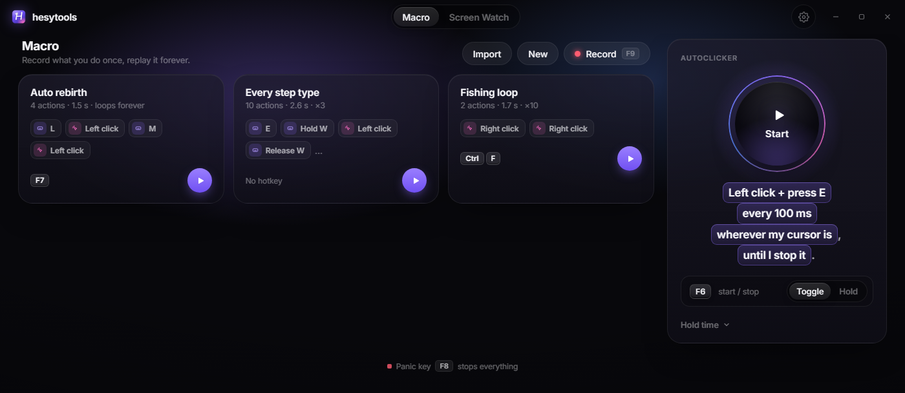
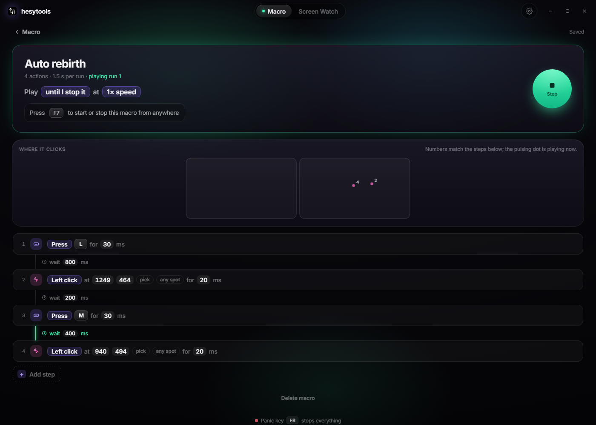
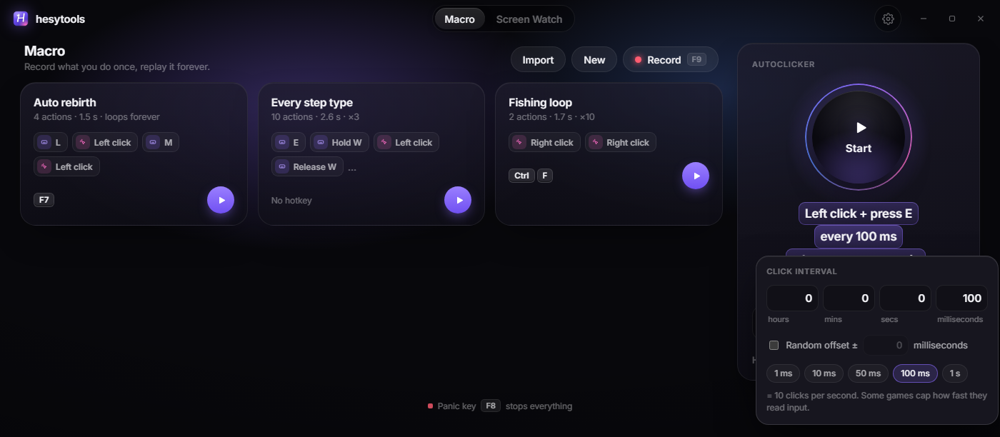
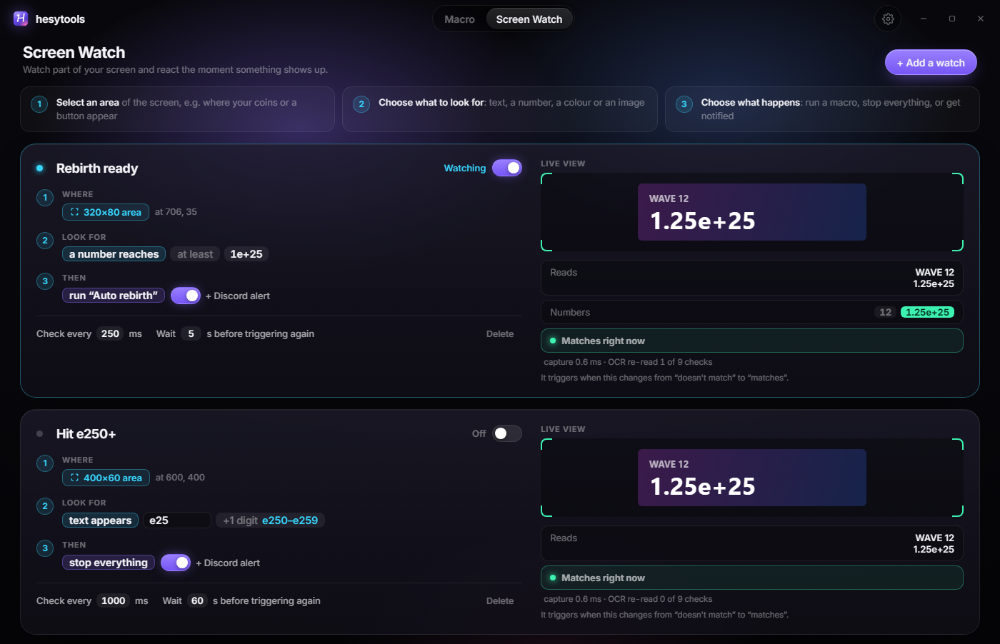

<div align="center">

# 🦋 hesytools

**Everything you actually need from an automation tool, in one place.**

[](https://github.com/Hesykhia/hesytools/releases/latest)
[](https://github.com/Hesykhia/hesytools/releases)

<br/>

[**⬇ Download Latest**](https://github.com/Hesykhia/hesytools/releases/latest) &nbsp;&nbsp; [All Releases](https://github.com/Hesykhia/hesytools/releases) &nbsp;&nbsp; [Report a Bug](https://github.com/Hesykhia/hesytools/issues)

<br/>



</div>

<br/>

## 💭 Why I made this

This project has been in development for a little over 6 months, I originally made it to Macro / Autoclick in roblox but it has been expanded to be used in all types of games or general tasks.

I couldn't find a single macro program that did everything I needed without being a mess to use or coming from some sketchy website.

TinyTask tracks mouse movement well but you can't touch the recording after the fact. Logitech's macro software lets you edit delays and keypresses but only works with their hardware. Nothing I found could also watch the screen for changes during a macro. For clicking, there'd be one app that only did keyboard, another that only did mouse, and none that could do both at the same time on a custom interval with a proper hotkey toggle.

I figured if I was going to use six different programs anyway, I might as well just build the one that has everything. So I did.

**v5 is a full rebuild.** The old version was one huge Python file. Reading the screen pinned the CPU, clicks didn't land in fullscreen games, and the exe was 240 MB. This one is rebuilt from scratch: it sends real hardware-level input, reads the screen with Windows' own OCR only when something actually changes, sits under 1% CPU when idle, and the installer is about 2.5 MB.

<br/>

## 🔧 What's inside

### 📼 Macro

Hit **Record** (or F9), do your thing, and every key, click and pause turns into a step you can actually edit. Change keys, timings and click positions right in the list, reorder or delete steps, add loops, type text, or drop in a "wait until the screen shows…" step. Mouse movement can be replayed the way you did it, or made instant so it just jumps between spots. Each macro gets its own hotkey, repeat count and speed.

While you record, a thin red outline goes around your screens (it doesn't block your mouse) and the steps show up live as you go. Got macros from the old version? **Import** brings them straight over.



### ⚡ Autoclicker

Click a mouse button, press a key, or **both at the same time**, at any interval (hours / mins / secs / milliseconds) with an optional random offset so it doesn't look mechanical. Single or double click, at your cursor or a fixed spot you pick, forever or for a set number of clicks or time. Toggle or hold with a hotkey, even while a game is focused.



### 👁️ Screen Watch

Draw a box anywhere on any monitor and react the moment something shows up. Look for:

- **Text** appearing or disappearing
- **A number** reaching a value (`1,234`, `1.25e+25`, `12.5K`, `3M`, `1.2B` all work)
- **e-values with a range**: `e25` + 1 digit catches e250 to e259, `e2` + 2 digits catches e200 to e299
- **A colour** showing up (pick it straight off your screen with the eyedropper)
- **An image**, like a button or icon
- **Anything changing** at all

Then run a macro, stop everything, or just get notified. The live view shows exactly what it's reading, so you can see why something did or didn't trigger.



### ⚙️ Everything else

- **Discord alerts** through a webhook when a macro or the autoclicker finishes, or a watch triggers
- **Panic key** (F8) that stops everything instantly
- **Every hotkey in one place**, including each macro's own
- **Start with Windows** quietly in the tray, and optionally run a macro on start
- **Admin mode** for apps that run as administrator
- Works across **multiple monitors**
- **Updates itself** from GitHub when a new version is out (or later, your call)

<br/>

## 📥 Getting started

1. Head to [Releases](https://github.com/Hesykhia/hesytools/releases) and grab the latest `hesytools_x.x.x_x64-setup.exe`
2. Run it. No admin needed, no Python, nothing else to set up. If Windows shows "Windows protected your PC", click **More info**, then **Run anyway**. It shows that for apps without a paid signing certificate
3. Closing the window keeps it running in the tray so your hotkeys keep working. Quit from the tray icon
4. When a new version is out, hesytools tells you and updates itself in a few seconds. Your macros and settings stay

If something ignores your clicks or keys, that app is probably running as administrator. Turn on **Admin mode** in Settings.

<br/>

## 🛠️ Best usability

A few things I've learned from using it over long periods:

- Most monitors have an inactivity timer. When the screen turns off, there's nothing for Screen Watch to read, so turn that off if you're leaving it running for a long time.
- Cover all your cases. If a value is normally `e+20` and you need it to keep going past that, use `e2` with **+1 digit** so it catches e20 to e29, and add the final value too (like `e50, inf`) so a watch never gets stuck.
- Make the Screen Watch box cover the entire value with a little wiggle room in case it moves. It only looks for what you tell it to, so extra stuff in the box won't throw it off.
- For games, a hold time of 10 to 20 ms makes sure every press registers.
- Leave **Record mouse movement** off if you want macros as fast as possible. Clicks still jump to the right spot.

<br/>

## 🛠 Building from source

You'll need Rust, Node 20+ and pnpm (plus the MSVC build tools on Windows).

```sh
pnpm install
pnpm tauri dev      # run it
cargo test -p engine
```

Release builds are signed so the in-app updater can trust them. To build an unsigned installer for yourself:

```sh
pnpm tauri build --config "{\"bundle\":{\"createUpdaterArtifacts\":false}}"
```

Publishing an update is `scripts/release.ps1 -Version x.y.z -Notes "..."`. It builds, signs and uploads the release, and everyone gets the "hesytools got an update" prompt next time they open it.

The app is Tauri (Rust) with a Svelte UI. Everything that touches Windows (input, hotkeys, timing, screen capture, OCR) lives in `crates/engine`, separate from the UI. Settings and macros are plain JSON in `%APPDATA%\com.hesy.hesytools\`.

<br/>

<div align="center">
🦋 Made by hesy
</div>
